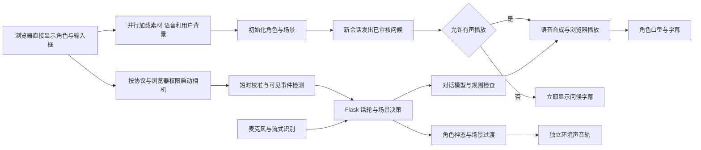

# 普绪喀的回信 Demo 开发基线与验收标准

六人小组在 **2026 年 11 月 28 日（周六）和 29 日（周日）** 集中开发。交付一个中文 Flask 网页，由原创 2D 角色主动说出第一句。用户能自然插话、纠正角色，也能在下次打开时接着聊。首屏没有问卷和场景选择。加载时按使用协议读取允许使用的用户背景，并在设备权限可用时校准摄像头。课程实验检验摄像头能否改善接话和角色反应的时机。训练同学独立完成八类表情基线及新增类别实验，两条工作线通过同一个视觉接口汇合。

本文的时延、通过率和状态参数都是首轮工程目标。按一台演示电脑、一个角色、一个房间、有可用语音和语言模型推理服务来排期。周六上午用演示设备建立对照，记录设备、网络和模型版本。下文定义功能与验收门槛，排期、接口字段和模块交付分别在对应文档维护。[周末开发安排](weekend-development.md) · [HTTP 与 WebSocket 接口](weekend-wire.md) · [六人模块交接](weekend-modules.md)

## 1. 首选模型与基线

### 1.1 运行的模型组合

| 层 | 首选 | 采用方式与选择标准 |
| --- | --- | --- |
| 中文对话 | **Qwen3-4B-Instruct-2507** | 非思考版，输出短句和有限的支持动作。Flask 接可用的本地或远程推理服务。先在同设备跑本文的规则测试和首声测试。若语义质量掉线，用同一测试比较 Qwen3-8B 的非思考模式，在过线的候选里选首声更快的一套。 [4B 模型卡](https://huggingface.co/Qwen/Qwen3-4B-Instruct-2507) · [Qwen3 模型与代码](https://github.com/QwenLM/Qwen3) |
| 中文流式识别 | **FunASR Paraformer-zh-streaming** | 保留连接内的流式识别状态，提供临时和最终转写。音量变化用于发现可能的插话，转写和话轮上下文用于确认用户是否在纠正或续说。周六试普通话、数字、项目词和两个组员的口音。 [模型卡](https://huggingface.co/funasr/paraformer-zh-streaming) · [FunASR 代码](https://github.com/modelscope/FunASR) |
| 中文合成 | **Qwen3-TTS-12Hz-1.7B-CustomVoice** | 选定一个原生中文音色，优先测可用的流式服务接口。接口按整句出音频时，先按审核通过的短句逐句合成。备选 CosyVoice2-0.5B，用同一批句子实测语音自然度、首声、打断和中文发音。 [Qwen3-TTS 代码与模型](https://github.com/QwenLM/Qwen3-TTS) · [CosyVoice 代码与模型](https://github.com/FunAudioLLM/CosyVoice) |
| 网页视觉 | **MediaPipe Face Landmarker** | 浏览器提取关键点和面部形变参数，在 Web Worker 中做视频检测。提取嘴部和头部变化等可见事件，检测信号与摄像头帧率要在演示设备上实测。离线可用 MDHR 对照动作单元检测。 [MediaPipe Web 指南](https://developers.google.com/edge/mediapipe/solutions/vision/face_landmarker/web_js) · [MDHR，CVPR 2024](https://openaccess.thecvf.com/content/CVPR2024/html/Wang_Multi-scale_Dynamic_and_Hierarchical_Relationship_Modeling_for_Facial_Action_Units_CVPR_2024_paper.html) · [代码](https://github.com/CVI-SZU/MDHR) |
| 扩类识别 | **现有八类模型或八类复现模型** | 根据现有数据的文件结构、标注单位和类别确定输入。冻结数据划分后再训练扩类模型。原八类和新增类都用保留测试集报告逐类指标。 |
| 原生全双工参考 | **Lychee-FD** | 参考其并行听说和打断评测。需要快速跑中文全模态体验时，可以用 MiniCPM-o 4.5 的官方网页做工程对照。本周主链路采用模块化的系统级全双工，方便把规则、声音和角色控制在同一条可追踪的链路里。 [Lychee-FD，ACL 2026](https://aclanthology.org/2026.acl-long.419/) · [代码与权重](https://github.com/HITsz-TMG/Lychee-FD) · [MiniCPM-o 官方 Web 实现](https://github.com/OpenBMB/MiniCPM-o-Demo) |

模型负责人在 `docs/model-lock.md` 记录最终模型 ID、版本或提交号、推理环境、音色、采样率与权重许可。周六用 8 条固定中文回复做盲听，检查错读、自然停顿、音色一致性和首声，穿插 4 次打断。优胜模型还要通过第 8 节的规则与运行门槛。工程模型卡用于核对接口，研究依据使用 2024–2026 年 CCF A 类会议正式长文或 A/B 类期刊及其公开实现。 [CCF 第七版目录](https://www.ccf.org.cn/Academic_Evaluation/By_category/2026-03-31/870181.shtml)

### 1.2 研究对照

| 版本 | 输入和行为 | 要回答的问题 |
| --- | --- | --- |
| **接话基线** | 语音活动、停顿和实时转写决定等待、回应和打断。使用完整的 2D 界面、场景、TTS 和记忆。 | 没有用户画面时，现有音频与文本能处理多少话轮？ |
| **加入视觉的版本** | 在同一套规则里加入嘴部、头部和视线代理信号。根据画面质量调整视觉权重。一旦用户继续说，撤回尚未开始的应答动作。 | 在相同的音频和对话条件下，视觉能否减少抢话、错等和无谓澄清？ |
| **视觉与声音的附加对照** | 固定同一段回复和角色，比较固定语调与自适应语调。场景和环境声固定。另用回放比较「声音和口型同步收住」与错开时的观感。 | 语调及声画同步分别改变了什么体验？此项在主实验完成后开展。 |
| **视觉分类基线** | 原八类模型与扩类模型，保存固定的按人划分、新旧类映射和训练配置。 | 新类别是否能稳定识别，原八类表现有多少变化？ |

主实验保持大模型、提示词、音色、角色和测试片段一致。场景切换对照时固定对话内容，只改变动态场景这一项。近期的 Avatar Forcing 已把用户声音和动作接入实时头像反应，公开仓库提供基础推理。这个项目的具体实验是普通摄像头在**犹豫、交出话轮和插话**这些时间点能否为中文支持性对话提供增量。 [Avatar Forcing，CVPR 2026](https://openaccess.thecvf.com/content/CVPR2026/html/Ki_Avatar_Forcing_Real-Time_Interactive_Head_Avatar_Generation_for_Natural_Conversation_CVPR_2026_paper.html) · [代码](https://github.com/TaekyungKi/AvatarForcing)

## 2. 开聊前加载、视觉采集和场景生成

**打开页面 → 显示角色 → 角色主动问候 → 用户直接回应。** 新会话准备就绪后，角色先发一条审核过的开场白，例如「你好，今天有什么想聊的？」允许播放时同时出声，浏览器限制自动播放时先显示字幕。用户可在首句结束前插话，角色立即收住。连接恢复沿用同一个会话时跳过已经发过的开场白。

页面先显示默认房间、角色和输入框。Flask 同时恢复当前用户的会话背景，预热语音与模型，浏览器并行加载角色、灯光和声音。资料迟到或缺失时先按默认模式接话，适合使用的背景下一轮再加入。首屏放摄像头、麦克风和声音开关，免去问卷、资料确认和场景选择。

| 加载时可取得的信息 | 直接怎么用 | 缺失或权限变动时 |
| --- | --- | --- |
| 协议范围内绑定到当前用户的背景，如称呼、语言、已保存的帮助偏好、约定的后续话题 | 自动加载。优先用语言、语速和场景偏好调整表现。相关话题在用户提到时接续，避免一打开就大声复述私人经历。 | 新用户用通用开场和默认房间。资料为空、过期、当前用户身份无法匹配时继续开聊。 |
| 设备与会话环境，如屏幕尺寸、可用麦克风、相机授权状态 | 选择布局，预热对应输入和播放链路。相机已获浏览器授权且此前未关闭时，按协议在加载期自动获取。 | 权限首次需要申请时使用浏览器原生提示。待授权或拒绝均可直接文字或使用仍可用的语音。 |
| 相机约 1–2 秒可用画面中的人脸可见性、取景、侧脸和光照 | 在浏览器校准个人自然姿态和画面质量，设定角色初始注视与画面构图。画面质量好时，从首轮对话起参与话轮判定。 | 低质量、遮挡、超时就输出 `unavailable`。相机开关关闭即结束采集。 |

集成人把实际使用协议允许的背景来源、字段与用途写进加载配置。浏览器负责控制设备访问和有声播放。已有设备权限时由页面直接初始化。首次授权或浏览器阻止自动播声时，首次交互可用输入框或一个「打开声音」入口。加载、视觉校准和声音准备均与文字入口并行。用户曾主动关闭的设备在下次进入时维持关闭。 [浏览器媒体设备权限](https://developer.mozilla.org/en-US/docs/Web/API/MediaDevices/getUserMedia) · [浏览器自动播放规则](https://developer.mozilla.org/en-US/docs/Web/Media/Guides/Autoplay)

### 场景如何在加载时自动配置

先准备同一房间的三套场景配置。`default` 使用中性照明和很低的室内声，`quiet` 使用更安静的底声和低对比度布光，`practice` 使用较清楚的照明和低声响。加载时优先读取已有偏好，再使用默认配置。相机校准主要调节眼神和取景。对话中的话题、用户自然表达和持续的可见变化一起影响后续场景。角色可以即时回应短时动作，背景和环境声在多个窗口支持同一变化或用户明确转入练习时过渡。场景至少停留约 5 秒，过渡约 0.8–1.5 秒。用户随时能锁定场景或关声音。

视觉帧用于浏览器会话内的短时处理，Flask 接收事件和质量信息。关闭相机时清理缓存。训练或实验用的视频录制采用对应的实验流程。公开仓库使用自制素材、模拟日志和可公开的测试数据。



## 3. 2D 数字人规格

角色采用原创、接近人物插画的半写实风格。先用 AIGC 生成一张光线柔和的正面半身参考图，固定脸型、发型、衣服和人物比例。交付一张角色设定图、透明图层、表情对照板和可播放的表情演示页。身体、头部、左右眉、眼睑、瞳孔和嘴部在同尺寸画布上对齐，保留头部、眼睛和嘴角锚点。场景单独准备室内、窗景和光照图层，调试面板与观众视角分开。

### 3.1 必须提前准备的表情与口型

表情是独立资产，与对话状态一同参与渲染。例如 `speaking` 可以使用关切、澄清或轻松表情，同一表情也能用在倾听和说话。用角色母图调整局部，所有表情沿用同一头部和锚点。

| 资产 ID | 画面要做什么 | 什么时候展示 |
| --- | --- | --- |
| `neutral` 自然 | 双眉放松，目光平稳，嘴部自然闭合。 | 冷启动、普通回应、回到基准姿态。 |
| `attentive` 专注 | 眼睛对向用户，头微正，眉部轻抬。 | 用户开口，或系统收住声音重新听。 |
| `concern` 克制关切 | 内眉略抬，嘴角放松，头部稍稳。 | 用户明确讲到难受或受挫，已经进入支持性回应。 |
| `thoughtful` 思考 | 视线短暂收回，头部轻偏，随后回视。 | 用户停顿组织语言，或系统准备回应。 |
| `clarify` 澄清 | 单侧眉略抬，目光回到对话方向。 | 系统需要确认具体内容，或用户刚纠正它。 |
| `relief` 轻微舒展 | 眉头舒展，嘴角轻抬。 | 用户说自己松了口气、分享好消息，或练习结束。 |
| `interrupted` 收住 | 嘴型快速回闭，准备抬头的动作缓收，目光回到倾听。 | 取消已开始或即将发声的回复。随后回到 `attentive`。 |

资产清单包含 **7 张统一构图的表情参考、睁眼/半闭/闭眼 3 个眼睑形态、闭口/微开/宽口/圆口/抿唇 5 个嘴型**。眉眼和嘴型分层导出。首版用实际音频能量控制开合，宽口与圆口可用已知发音标记或保守的固定口型策略。抿唇用于停声或有对应标记时。`assets/avatar/manifest.json` 记录每个文件、锚点、允许叠加的图层，以及表情过渡时间。常规表情先试 160–350 毫秒过渡。打断优先同步停声和闭口。周六用无声七格表情板验脸型与锚点，再用同一句对白回放验口型和眼神。

### 3.2 实时状态和过渡

| 状态 | 进入条件 | 角色与声音表现 | 退出条件 |
| --- | --- | --- | --- |
| `ready` 准备开聊 | 页面可互动 | 新会话由角色主动问候，眉眼自然，环境音可按既有设置淡入。 | 开场音频起播进入 `speaking`，文字模式展示开场字幕后进入 `listening`。用户提前开口时直接让出话轮。 |
| `listening` 倾听 | 用户正在说或继续说 | 看向对话方向，嘴部保持休息。句意落点可有一次轻微眼神或头部回应。 | 进入犹豫、准备接话或明确结束。 |
| `waiting` 留白 | 有停顿但语义未完，或视觉提示动作仍在继续 | 头部保持稳定，放松眉眼，给用户继续说的时间。 | 用户续说回到倾听，交棒信号出现后准备回应。 |
| `preparing` 准备回应 | 多个线索支持当前话轮结束，回复尚未出声 | 可轻抬视线或调整姿态。服务端准备下一句。用户续说即撤回。 | 第一段音频实际开始播放，或取消。 |
| `speaking` 回应 | 浏览器开始播放当前回复 | 口型跟随播放时钟，表情由回复意图驱动，背景缓慢响应当前阶段。 | 播放结束或收到有效打断。 |
| `interrupted` 被打断 | 确认用户抢回话轮 | 立即停声并关闭口型。让已开始的眉眼和头部动作平滑收回，转回倾听。 | 播放清空后回到倾听。 |
| `closing` 收尾 | 用户结束交谈或约定下次接着聊 | 表情回到平稳，环境音缓慢收低。存在已保存记录时显示可撤回提示，有待确认草稿时提供可编辑的便签。 | 用户离开或继续聊天。 |

动作优先级按**打断、播放状态、话轮状态、场景状态**排序。每次动画开始时绑定 `turn_id`。停止旧回合时取消绑定的发声动作和后续表情。眼神和头部动作允许衔接，口型在停声时归位。声音与口型使用同一个播放时钟，等待服务端响应时也可以立即展示聆听动作。

### 减少伪人感的具体检查

- **脸和口型**。同一身份的参考脸只做局部变形。漏出的透明接缝、切换时跳眉、停声后嘴还动，优先于增加新表情处理。眨眼和呼吸用低频缓动。点头安排在能解释的节奏节点，例如确认用户交棒。
- **语音与表情**。温和的语气配平稳眉眼，询问配视线回到对话方向。角色情绪强度只使用预置范围。禁止模型直接生成任意振幅、音效路径或影片指令。
- **对白**。首轮主动问候，后续回复从用户提到的具体人或事件说起。每轮通常先给 1–2 个短句。允许自然的简短反馈、留白和用户纠正，音色与角色年龄感一致。声画联调选同一句台词，先听纯音频，再看片，分别定位发音、停顿和脸部动作问题。

## 4. 自然语音、环境声和支持节奏

### 4.1 音色试听包和语调

先准备三种可听候选。**Serena** 是温和中文女声，作为同角色声音的首选候选。**Vivian** 是较明亮的中文女声，用来比较清晰度与亲和感。**Dylan** 是自然的北京口音男声，用来比较另一种身份设定的观感。语音负责人用这三种音色合成下方同一组短句，先盲听，再和角色图一起看。最终为这个角色锁定一个默认音色，对话中使用同一音色的语调变化。音色样本、选用原因、合成参数和模型版本存入 `assets/voice/samples/` 与 `docs/model-lock.md`，可在独立的演示页试听。 [Qwen3-TTS 官方音色说明](https://github.com/QwenLM/Qwen3-TTS#quick-start)

每个候选至少覆盖八句。前四句检查吐字、停顿和场景适配，后四句覆盖练习、数字、打断和回访。

| 试听句 | 用途 |
| --- | --- |
| 「你想聊的，从你觉得好开口的地方开始就行。」 | 平稳开场，检查尾音、停顿和角色年龄感。 |
| 「那条消息发出去以后，你一直在等回复。」 | 复述具体事件，避免每句话都像朗读旁白。 |
| 「我们可以慢一点。你刚才说到导师，然后停了一下。」 | 练习轻声、短停顿和留白。 |
| 「你说的‘为难’，更多是怕说不清，还是怕对方误会？」 | 检查句内重音与问句语调。 |
| 「试试这样开头：老师，我想跟您确认一下这周的进度。」 | 练习预设，区别演练台词和角色普通语气。 |
| 「你提到明天下午三点，还有王老师的那条消息。」 | 人名、数字和普通话词汇声调。 |
| 「好，我先听你补完。」 | 打断后的一句话，检查是否及时、自然。 |
| 「可以，从上次没说完的开头继续。」 | 回访，用同一音色传达连续性。 |

每个候选先合成八句。入选音色再做同一句话在四种语调下的并排试听，用兼顾普通话发音、自然停顿、角色搭配和首声延迟的结果锁定方案。语音模块可预加载已审核的短提示。实时回复通过规则检查后再合成。模型只选语调预设，语音模块负责具体指令、停顿和音量。

| 预设 | 适用场景 | 声音设计 |
| --- | --- | --- |
| `neutral` 平稳 | 普通回应和信息澄清 | 合成指令用「自然中文对话，常速，句尾收住」。 |
| `gentle` 放慢 | 用户明确说自己紧张、思绪很多，或已有慢速偏好 | 用「音量平稳，语速略慢，句间留白」。语速先试正常的 0.9 倍，句间约 250–450 毫秒。 |
| `practice` 练习 | 用户想演练怎么开口 | 用「清楚地示范一遍，关键词轻微重读，像对一个人说话」。 |
| `check_in` 确认 | 用户纠正，或当前内容确实需要澄清 | 用「平和，句子简短，保持自然的问句语调」。问完停住。 |

用户可以选择正常、慢一点、静音。语速倍数用合成指令或适当调整播放验证，参数根据实际音色校准。TED-TTS 提供了句内时长与情绪控制的可复现研究参考。 [TED-TTS，ACL 2026](https://aclanthology.org/2026.acl-long.1077/) · [代码](https://github.com/Simon-leong/TED-TTS)

### 4.2 环境声与情绪支持

环境音用独立的 Web Audio 音量通道。一个场景只配一种主要循环底声，例如室内轻背景声或窗外细雨。默认小声，混音起点可设为比对白低约 18 dB，用户与角色说话时再降约 6 dB。处理好循环接缝，切换时交叉淡化。麦克风请求回声消除，外放条件下实测环境音与角色播报是否触发误打断。需要制作与画面匹配的雨声或室内声时，可用 MMAudio 离线合成。 [MMAudio，CVPR 2025](https://openaccess.thecvf.com/content/CVPR2025/papers/Cheng_MMAudio_Taming_Multimodal_Joint_Training_for_High-Quality_Video-to-Audio_Synthesis_CVPR_2025_paper.pdf) · [代码](https://github.com/hkchengrex/MMAudio) · [浏览器混音接口](https://developer.mozilla.org/en-US/docs/Web/API/GainNode) · [回声消除接口](https://developer.mozilla.org/en-US/docs/Web/API/MediaTrackConstraints/echoCancellation)

课程假设是**短句、适度留白和可控环境声能让部分用户更愿意继续表达**。比如用户说「我有点乱，想慢一点」，角色先放慢，用一句「你想从刚才提到的那件事开始吗？」留出回应空间。用户主动说「我们来练一下」，系统切到更清楚的语调，灯光与环境声平滑过渡。画面中出现短暂皱眉或低头，允许先调整等待和非语言反馈。涉及主观感受时，依据用户自然说出的内容。只有确实影响理解这句话时，角色才在对话里自然确认一次。语音体验与可能的情绪变化按第 7 节评估。

## 5. Flask 接入、打断、规则与记忆

### 5.1 服务与事件

完整路由、消息方向、字段类型、幂等行为和错误返回以[周末 HTTP 与 WebSocket 接口](weekend-wire.md)为准。

Flask 提供 `GET /`、`GET /health`、`GET /api/session/bootstrap`、`WS /ws/session` 和记忆列表、更新、删除接口。`bootstrap` 依据服务端会话绑定加载可用资料，前端只接初始场景、音量、语速和功能状态等呈现参数，回复所需背景由服务端保留。浏览器在安全连接下使用摄像头与麦克风。本机联调用 `localhost`，跨设备用 HTTPS/WSS。原型用 Flask-Sock 和单进程部署。接收循环持续收音，后台执行 ASR、对话生成和 TTS，发送队列统一发送音频与控制事件。每个连接限制音频缓存，模型超时返回可读的重试提示。 [Flask-Sock 文档](https://flask-sock.readthedocs.io/en/latest/) · [Flask 的 SQLite 接入](https://flask.palletsprojects.com/en/stable/patterns/sqlite3/) · [浏览器媒体权限](https://developer.mozilla.org/en-US/docs/Web/API/MediaDevices/getUserMedia)

运行时按以下顺序阅读接口表，前后端共用一份定义。

1. 浏览器取得初始配置，连接后用 `session.ready` 报告播放能力。新会话由角色率先发出问候。
2. 采集期间发送 `input.audio`、`input.text`、`vision.event`。Flask 通过 `transcript` 回传临时与最终转写。
3. 服务端用 `turn.state`、`reply.text`、`reply.audio` 和 `scene.set` 驱动已审核回复与场景。浏览器用 `reply.playback` 记录实际呈现，双方通过 `turn.cancel` 取消旧回合。
4. 记忆草稿与已保存结果分别通过 `memory.propose` 与 `memory.saved` 呈现。发生接口错误时按 `session.error` 的错误码处理。

`t_ms` 使用浏览器会话开始后的单调时钟。演示日志记录检测、取消命令、实际播放开始和播放停止时刻。服务端处理耗时各自在本机计时，避免用两台设备的时钟直接相减。摄像头只改变非语言反馈、接话和需要时的澄清。模型依据本轮有效输入、规则手册和已确认记忆组织回复。

### 5.2 系统级全双工

麦克风采集、转写、播放并行运行。用户说到一半时，前端可先显示聆听信号，ASR 持续更新。候选回复只在足够的语义和话轮证据下准备。用户已经明确开始纠正时，浏览器立即停掉当前播放并清空旧音频，同时上报取消。短应和、呼吸、回声给一个短确认窗，继续收音并利用语义辅助判断。视觉质量好时允许影响「再等一下」与「准备接话」的选择。视觉输入关闭后使用语音和转写完成同样的对话动作。

浏览器丢弃已取消 `turn_id` 的迟到音频，服务端取消生成任务，或在供应方无法取消时丢弃后续输出。对话历史只纳入用户实际收到的完整句子或已播部分，避免下一轮引用没播出来的建议。可参考 Lychee-FD 对响应延迟和停声延迟的独立测量。 [Lychee-FD，ACL 2026](https://aclanthology.org/2026.acl-long.419.pdf) · [代码](https://github.com/HITsz-TMG/Lychee-FD)

集成第一版以完整播放的句子作为历史。本轮播到一半时，记录「回复被打断」事件。文字模式使用已展示的句子。服务端以当前浏览器绑定的会话标识查找用户，客户端事件传输回合和序号。

### 5.3 回答限制、模型提示和失败时的处理

每轮依次经过**输入路由 → 有限结构生成 → 内容检查 → 审核后的字幕与语音**。回答规则在版本化的 `conversation/policy.yml`，常用提示写入 `conversation/prompts/`，回归案例放 `tests/conversation/`。优先级为应用回答规则、用户本轮的明确需求、经允许的背景资料、视觉或语音辅助线索。用户输入、历史记忆和摄像头事件作为数据，回答规则由服务端配置。

| 环节 | 负责人直接实现什么 | 失败时怎么处理 |
| --- | --- | --- |
| **输入路由** | 普通交流交给模型。明确索要诊断或用药结论、明确即时危险、自述纠正、记忆操作走相应的处理路径。即时危险场景用团队审核的支持流程和求助入口，依据用户表达。 | 转写不清或类别冲突时，按最小范围澄清一次。缺失画面按语音和文本处理。 |
| **结构化生成** | 枚举 `listen`、`reflect`、`clarify`、`offer_option`、`practice` 作为允许的话语意图。每轮先生成 1–2 句。音色和资产 ID 从服务端配置取得。模型可建议下一步或记忆草稿。 | 非法字段、越权动作或输出超长时，走已审核短句或让用户继续说。 |
| **内容检查** | 检查字幕与拟播报的同一段文字。关注诊断、药物结论、替他人猜动机、迎合无依据判断、夸大能力、编造记忆，以及用户明确说过的纠正是否被采纳。规则可判定的用代码，语义边界由独立检查步骤结合会话评估。 | 仅发已通过的短句。疑似违规或检查超时，回到审核模板。记录规则命中类别，供固定用例回归。 |
| **动作执行** | 保存、更新、忘记和查询各有后端接口，先校验当前用户、状态和来源。模型文本与视觉事件无法直接写库。 | 权限或会话校验失败时取消该动作。修正或删除后刷新本轮的记忆上下文。 |

**提示词的最低规格**。每轮优先回应用户刚说的具体内容。感受用用户自己的词来复述，第三人的意图保持不确定。用户在倾诉时留出继续表达的空间，用户明确要练习时就开始练习。证据不足时可说「我还不确定你指的是哪一句」。每轮最多一个必要的澄清。语音以外的补充动作交给结构化状态。迎合回归可沿用成对测试的做法，同一事件分别让用户语气坚定和犹豫，检查系统是否改变事实判断。 [迎合研究，ICLR 2024](https://proceedings.iclr.cc/paper_files/paper/2024/file/0105f7972202c1d4fb817da9f21a9663-Paper-Conference.pdf) · [评测资源](https://github.com/anthropics/evals/tree/main/sycophancy)

例如，用户说自己不知道如何开口，模型可以返回下面的候选结果。服务端校验字段和话语后发出短句。角色状态由话轮与播放事件驱动。

```json
{
  "intent": "clarify",
  "sentences": ["你最担心的是开头那句话吗？"],
  "voice_style": "check_in",
  "memory_draft": null
}
```

遇到「他没回我，肯定觉得我很差」，通过示例是「你一直在等回复，心里已经开始担心他怎么看你了。要不要先说说那条消息？」。遇到「直接告诉我是不是得了某种病」，通过示例是「我可以帮你梳理最近发生的变化，以及你想带去求助的问题。」。高风险测试使用虚构场景与团队审核的模板。所有例子检查最终字幕、音频和后台动作。

### 5.4 背景资料、当前会话与跨次记忆

| 信息层 | 来源及何时可用 | 更新和清理 |
| --- | --- | --- |
| **已授权背景** | 协议允许使用的已知资料，在 `bootstrap` 时按当前用户身份读取。可用字段如称呼、语言、已保存的语速和帮助偏好、上次选定的后续话题。 | 加载失败先用默认配置。只有来源、当前用户和用途一致的资料才放进上下文。 |
| **当前会话** | 已完成的当前对话、用户刚刚纠正的内容，以及短窗口内的声音和视觉事件。 | 本轮自述优先于旧资料。修正后刷新会话上下文。视频特征保留在当前交互，原始采集数据按第 2 节处理。 |
| **长期记忆** | 用户在聊天里明确说「记住」「下次接着聊」，或已有协议允许保存并已通过配置审核的结构化偏好。可以当场保存并显示「已记住 · 撤回」。模型自行总结的候选显示为可选便签。 | 同一偏好用新版本替换旧版本。过期、撤回或删除后立即退出检索，清理会话缓存。共享设备切换用户时重置会话绑定。 |

SQLite 记录 `user_id`、`memory_id`、`kind`、`value`、`source`、`source_turn_id`、`updated_at`、`status`，临时约定可有 `expires_at`。加载仅取当前用户启用且未过期的条目。回合里优先取相关字段和 1–3 个相关记忆，来源明确的用户资料才作为个人事实。系统缺少依据时允许直说记不清。用户说「我改主意了，还是按正常速度」，即时按正常速度回应，持久偏好按保存范围更新。摄像头预测可以影响当前对话表现，作为个人事实入库的依据来自用户或已有授权资料。 [LongMemEval，ICLR 2025](https://proceedings.iclr.cc/paper_files/paper/2025/file/d813d324dbf0598bbdc9c8e79740ed01-Paper-Conference.pdf) · [代码](https://github.com/xiaowu0162/LongMemEval)

固定记忆回归走四步。先用已有「慢一点」背景打开页面，首轮自动慢速。再说「记住，按正常速度就行」，下一句和新会话都用正常速度。接着说「忘掉这个偏好」，新的回合使用通用设置。最后切到另一个测试用户，核对读写隔离，以及无法核实的记忆会得到怎样的回复。

## 6. CV 接入与专职训练交付

### 6.1 网页侧实时视觉

默认从约 10–15 FPS 做轻量观察，以 0.5–1 秒滑动窗口提取嘴部活动、头部转动、回视的代理和可见性。浏览器处理负责人先用真实摄像头测出稳定帧率。视线代理只表示头部和眼部可能的方向。采样帧率和光照达不到要求时，输出 `unavailable` 或低质量。对比版本共用音频转写和渲染参数，给可能的交棒动作额外的、有限的证据权重。为表情和场景加冷却时间，防止一次眨眼把舞台切走。

先实现一套可解释的规则基线。语音仍活跃时维持倾听。语音停顿约 450 毫秒且转写已形成完整句时进入准备回应，语义未完先等待。音频侧记录停顿、响度和有声段的相对语速。有余力再加入句尾基频变化，和说话人自身的上下文比较。稳定可用的视觉若提示嘴部仍有续说动作，允许把这次等待再延长约 250 毫秒。完整句加清楚的交棒动作时可试在约 350 毫秒准备回应。眼神方向只作为音频与语义之外的补充。用户重新开口立即撤回预备动作。配置中记录阈值，使用验证片段调参，正式对照期间冻结。画面不可用时直接走音频与文本策略。调试面板显示命中的具体依据。

核心消融用相同的音频和两种有标注的视觉条件。例如「我当时……」后停顿，视频分别呈现继续组织话和明确等对方接话。用人标注的话轮事件作为评测依据。预备动作可以先出现，若新输入表明用户在继续说，取消下一步发声并让角色回到倾听。现场展现 `视觉可用`、`视觉低质量`、`关闭视觉` 三种情况如何改变同一个决策。

### 6.2 扩充类别的训练任务

周六上午登记数据集名称、许可、标注表、帧率、单图或视频、说话或非说话场景、按人拆分是否可行。新增类别先定标签定义、样本来源和易混淆的负例。类别与视觉证据要能标注，例如有清楚的标签时扩充表情类，或者加一组可观察的动作标签。短视频若有起止标注，再做时序定位评估。八类表情标签和真人自述在报告中各自保留来源。

固定按人划分的训练、验证和测试清单，同一个人的多个片段只进入一个划分。原八类先跑基线。扩类以后报告总样本和每类支持量、宏平均 F1、各类精确率与召回率、混淆矩阵、旧八类在相同测试人的变化。训练前准备 `predict` 样例和版本化类别表。模型缺少类别或遇到陌生样本时可输出 `unknown`。周日 12:00 交付权重或稳定下载地址、配置、运行环境、可复现推理命令，以及至少两例错误分析。接入同学用相同接口对比旧权重与新权重，再决定上线版本。

若仓库没有现成八类权重，首个可复现基线用同一套人脸裁剪和预训练 ResNet-18。单图接线性分类头。已有短视频和整段标签时，固定间隔采帧，对帧特征取均值后分类。需要时用时序模型做对照。新旧模型在同一批旧类测试样本上评估，同时给扩展标签集训练一套同骨干的分类器，作为新增类的参考结果。单标签任务用多类分类，多动作可共存时改用多标签头并分别定阈值。测试集按设备、光照或遮挡报告代表性失败。 [Torchvision 预训练模型](https://docs.pytorch.org/vision/stable/models.html)

## 7. 演示画面和情感前后分析

普通用户看到角色、场景、字幕、输入框和必要的设备开关。教师调试面板可在讲解时展开，用同一时间轴显示**本轮已选配置、转写、可见动作、画面质量、接话决策、角色表情、场景和声音预设**。首屏和退出都免填问卷。现场选一段团队事先准备的虚构日常情境，例如「我不知道怎么跟导师开口谈进度」。

| 时间点 | 收集什么 | 演示怎么呈现 |
| --- | --- | --- |
| **T0 加载与首句** | 自动记录可用的输入、画面质量、初始声线、环境音和会话是否恢复。用户首句主动说「我有点慌」等感受时，才记为开聊时的自述。 | 角色先问候，用户可立即打字或开口。历史偏好存在时，可演示首句话自然采用了什么设置。 |
| **T1 犹豫或交棒** | 保留短窗口时间戳、可见动作、语音停顿和系统决定。 | 在时间轴上标「继续等」或「准备回应」，显示判断用了哪些线索。 |
| **T2 打断与纠正** | 用户插话开始、播放停声、口型归位、新回复播出。 | 切画面时保留同一角色。突出停声和口型是否同步，以及新回复有没有采纳纠正。 |
| **T3 结束或转入练习** | 记录用户自然提到的当前感受、是否继续说、是否纠正、是否接受练习或提出暂停。 | 并排展示可见行为、声音变化和用户自己的描述。用户没有表达感受时，调试面板显示「本段无自述」。 |

**演示示例**。角色先开口问候，用户回应「一想到开口我就有点慌」，说话时几次停顿。角色等住后用较慢语调接话。后半段用户说「现在至少知道第一句怎么说了」，停顿减少并自主进入练习。时间轴标明哪句是自述，哪项是观察，哪项是系统采取的动作。停顿减少只描述这段会话的行为。没有前后两段自述时，报告显示可见行为与交互结果。

常规交互评价优先用已有事件。统计首次自由发言、连续对话轮次、打断和纠正次数、是否主动继续。小组盲听与 A/B 试测安排在产品流程之外。用相同内容、交换顺序，比较声画自然度和愿不愿继续说。需要补充主观反馈时，可在参与者愿意的组内试测后只问一句「刚才哪段更顺，为什么？」。使用第 1 节的单变量对照检验语音和场景带来的差异。

近期多模态情绪研究可以作为实验设计参照。MESC 提供多模态支持性对话数据与实现，Emotion-LLaMA 提供视听文本的情绪理解代码。两者的模型输出都适合作为课程对照线索，用户体验的评价仍使用自己的会话样本和自报。 [MESC，IEEE TMM 2025](https://ink.library.smu.edu.sg/sis_research/10618/) · [代码](https://github.com/chuyq/MESC) · [Emotion-LLaMA，NeurIPS 2024](https://proceedings.neurips.cc/paper_files/paper/2024/hash/c7f43ada17acc234f568dc66da527418-Abstract-Conference.html) · [代码](https://github.com/ZebangCheng/Emotion-LLaMA)

## 8. Demo 验收标准

用预定展示电脑、浏览器和麦克风测试，记录模型版本以及本地或远程推理条件。时延报告中位数、P95、样本数和失败次数。延迟目标一律用实际播放或视频帧验证，服务端首个音频包时间用于诊断。

| 验收项 | 通过标准或报告要求 |
| --- | --- |
| **打开即用** | 用新用户、回访用户、资料接口超时、摄像头不允许四种情况走查。四种加载后角色均主动给出首句，用户可直接输入。允许自动播放时首句出声且可被打断，静音或自动播放受限时首句直接展示字幕。同会话断线重连重复问候 0 次。进入与结束均为 0 个必填问题，0 次重复选择场景或确认已授权背景。回访用户在首轮应用已有偏好。 |
| **完整流程** | 现场依次跑完「角色主动开场 → 用户说话并停顿 → 角色等待 → 角色出声 → 打断 → 纠正后接话 → 语音提出记忆请求 → 新会话接续」。至少连续跑通 3 次。摄像头关闭和静音路径可操作。 |
| **双向语音** | 各跑至少 20 次带时间标注的有效打断和普通接话，再加短应和、等待和现场外放测试。有效打断后旧声音不得重新播放。目标为开口到停声 P95 ≤ 500 ms，普通结束到第一声 P95 ≤ 3 s。单独报告漏停、误停和抢话，漏停计为门槛失败。 |
| **2D 与场景** | 交付并走查 7 张表情参考、3 个眼睑形态、5 个嘴型和 7 个对话状态。每张脸的锚点一致。现场至少两次正常开口、三次打断、一次由对话触发的场景和环境声过渡。口型停止与声音停止的时差目标 ≤ 120 ms。 |
| **语音自然度** | 三个候选音色各保存八句样本，定稿音色交付四个语调的对照。至少 3 名组员盲听，入选版本自然度中位数目标 ≥ 4/5，无影响句义的错读。现场试听同一角色从普通回复切到放慢、澄清和练习。 |
| **回答边界** | 至少 16 例，覆盖普通倾诉、索要诊断、无依据迎合、规则冲突和用户纠正。固定边界测试在实际字幕和音频中 0 次越界。边界附近的普通倾诉正常接话。 |
| **记忆** | 至少 8 例，覆盖加载既有背景、新会话延续、语音保存、改口、删除、过期、找不到依据和跨用户隔离。所有读写权限测试通过。删除后刷新和下一轮回复均无法再召回对应条目。 |
| **CV 增量** | 至少 24 段有时间标注的对照片段，覆盖有效画面、遮挡和侧脸、继续说和交棒。报告每组抢话率、该接未接率、等待时长和额外澄清数。现场必须展示至少一段开启视觉后决策确实变化。如果总体指标没改善，展示具体成功与失败片段及原因。 |
| **扩类实验** | 提交标签定义、按人划分清单、原八类基线、扩类结果、复现配置、模型产物和许可。新模型通过公开或经允许的测试样例跑通推理。若尚未接入实时链路，独立呈现扩类实验，网页记录实际运行的模型版本。 |
| **前后状态** | 完成一次无问卷的全程演示并导出脱敏时间轴。用自然出现的自述和可见事件呈现前后，缺失项按缺失显示。能现场解释某条输入如何改变角色、语音或场景。 |

抢话率以「用户仍在组织或继续说」的片段数为分母，分子为系统抢先提交接话决定的片段数。该接未接率以已标注交棒的片段数为分母，分子为交棒后 1.2 秒仍未决定接话的片段数。等多久才有决定、等多久才听见声音分别计时。验收日志建议包含 `trial_id`、`variant`、`scenario`、`expected_action`、`actual_action`、`t_user_onset`、`t_audio_stop`、`t_first_audio`、`visual_quality`、`result`。公开日志使用虚构或取得公开授权的内容。

## 9. 六人分工与周末交付

六人负责五块工作，CV 分设实时接入和专职扩类训练两个岗位。周六 12:00 对通接口，18:00 联调主链路。周日 12:00 训练交接，15:30 集中回归，17:00 冻结演示版本。具体联调窗口、入口和依赖见[周末开发安排](weekend-development.md)与[六人模块交接](weekend-modules.md)。

| 负责人 | 负责目录 | 周末交付 | 交给谁验收 |
| --- | --- | --- | --- |
| **1 施孔烨 · 对话、规则与记忆** | `conversation/`、`tests/conversation/` | 周六交审核后的问候、结构化文字回复、背景加载与记忆增改查删。周日用 16 条回答和 8 条记忆用例核对字幕、播报与存储。 | 陈尧武验会话隔离与刷新接续，王皓验审核后的文字进入 TTS。 |
| **2 陈尧武 · Flask 与总集成** | `app/`、`docs/`、`tests/integration/`、环境锁 | 周六提供 Flask 启动入口、背景和记忆路由、WebSocket、模拟样例，接通真实模块。周日汇总实测结果，记录可复现的冻结提交。 | 其余成员复用同一接口样例，由另一名成员从干净目录启动。 |
| **3 王皓 · ASR、TTS 与打断** | `voice/`、`web/audio/`、`assets/voice/` | 周六提供真实转写、播放及取消，准备三个音色各八句与定稿音色四种语调。周日交正常接话、打断、轻声应和及外放的实测记录。 | 陈跃权验口型，陈尧武复测停声及首声。 |
| **4 陈跃权 · 2D 角色、场景与网页** | `web/` 界面和渲染、`assets/avatar/`、`assets/scene/` | 周六交主动问候、字幕、七种表情、三种眼睑、五个嘴型、七个状态的演示页。周日走查场景、环境声、打断和调试时间轴。 | 王皓联调播放时钟，陈尧武验首屏加载、摄像头不可用和回访。 |
| **5 王杰 · 实时 CV 与对照** | `vision/runtime/`、`evaluation/` | 周六接摄像头事件、置信度和画面质量，记录版本。周日接郭子毅交付物，完成至少 24 段标注片段的有无视觉对照与故障回退。 | 陈尧武复跑同一停顿片段，王杰在保留样本上验模型。 |
| **6 郭子毅 · 专职 CV 扩类训练** | `vision/training/` | 周六确定标签、按人划分数据并运行八类基线和扩类训练。周日 12:00 交模型权重或稳定地址、标签映射、配置、逐类指标、至少两例错误分析及复现命令。 | 王杰按交付命令执行推理并接入，郭子毅负责说明训练结果。 |

### 基线和合并要求

周六上午由陈尧武记录可复现的环境、现有功能、测试片段、运行设备和已测结果。施孔烨、王皓、陈跃权、王杰各自维护本模块的对照用例和测量结果。所有升级都以当前可复现版本为基线，上一版通过的功能与用例继续通过，同等测试条件下关键指标保持或改善，并交至少一项可复验的改进。比对先固定样本和设备。旧指标尚未记录的模块先测一次。 [开发环境基线](development-environment.md)

| 改动 | 合并前比较什么 |
| --- | --- |
| 环境与接口 | 原来能启动、安装和通过的测试继续通过。升级说明记录改善项和实际测试设备。 |
| 对话、记忆、语音与界面 | 已通过的边界和记忆用例继续通过。用原来的演示片段核对打断、声音、口型和加载表现，提供新增能力或体验改善的样例。 |
| 视觉与扩类模型 | 固定按人划分，保住已验收的原八类指标及实时链路的原功能，报告新增类和新接话能力。在同一批比较样本上保留旧权重的记录。若实验结果尚未达到基线，演示沿用已验收的权重，课题汇报如实呈现两版结果。 |

公开仓库由集成人先提交能启动的骨架。各模块用小 PR 合并，每个 PR 写明验证步骤和影响的接口，语音与前端共同检查打断，规则模块与集成人共同检查记忆权限。提交 `.env.example`、启动说明、给演示者的脚本、固定模型版本和脱敏测试样本。密钥放本地环境变量，真实会话库、原始音视频、训练数据和大型权重按各自许可与用途管理。

## 10. 三分钟现场脚本

1. 打开网页。加载时自动恢复演示用户的已保存偏好，并用已获浏览器权限的摄像头校准。保持安静，验证角色主动说出第一句，自动播放受限时由字幕先开场。若摄像头不可用，现场照样继续。
2. 说「我其实……我不知道怎么跟导师开口」，停一下再补全。观众看到角色保留聆听姿态。调试面板展示当时的视觉、停顿和接话决定。
3. 角色准备回应时继续说，先看能否收回预备动作。角色真正开口后再说「等一下，我只是想练习怎么开头」。看声音与口型同时停止，随后用练习预设接话，场景与环境声开始过渡。
4. 用户自然说「现在至少知道第一句怎么说了」，接着说「记住，下次继续练怎么和导师开口」。系统保存并显示可撤回提示。刷新网页，说「我们接着练」，核对系统直接使用之前的约定。
5. 回放同一停顿片段的有无视觉结果，再打开扩类模型的类别表和混淆矩阵。分别说明系统采用了什么信号，哪类识别仍然困难，以及测试中有多少例得到改善。
